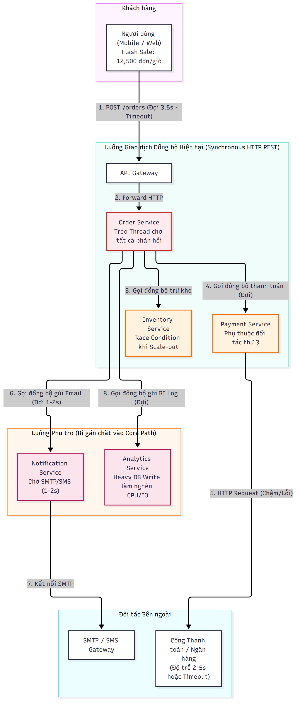
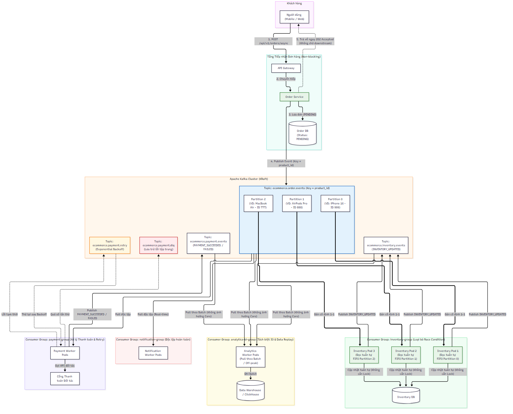

# Giải Pháp Kiến Trúc Event-Driven Cho Nền Tảng Thương Mại Điện Tử

## 1. Bối Cảnh & Phân Tích Vấn Đề (Context & Problem Analysis)

### 1.1. Phân loại dịch vụ hiện tại
Hệ thống thương mại điện tử hiện phục vụ ~50,000 DAU với 3,000–5,000 đơn hàng/ngày (dự kiến tăng trưởng 3–5 lần trong 12–18 tháng tới). Các dịch vụ được chia thành 2 nhóm đặc thù:
* **Luồng Giao dịch Cốt lõi (Critical Path):** `API Gateway`, `Order Service`, `Inventory Service`, `Payment Service`. Yêu cầu độ trễ thấp, tính nhất quán cao và không được mất dữ liệu.
* **Luồng Sự kiện Phụ trợ (Non-critical Path):** `Notification Service`, `Analytics Service`. Chấp nhận độ trễ (Eventual Consistency) nhưng khối lượng sự kiện lớn.

### 1.2. Nguyên nhân gốc rễ (Root Cause)
Việc sử dụng giao tiếp đồng bộ (**Synchronous HTTP REST**) giữa tất cả các dịch vụ gây ra hiệu ứng sụp đổ dây chuyền (Cascading Failure):
1. **Order Service bị Timeout:** Phải treo luồng chờ `Payment Service` phản hồi từ đối tác bên thứ ba.
2. **Trải nghiệm người dùng kém:** Khách hàng phải chờ `Notification Service` gửi email/push xong mới nhận được phản hồi đặt hàng.
3. **Nghẽn cổ chai tài nguyên:** `Analytics Service` xử lý dữ liệu nặng trong giờ cao điểm làm chậm toàn bộ hệ thống.
4. **Ràng buộc chặt chẽ (Tight Coupling):** Các dịch vụ phụ thuộc trực tiếp vào địa chỉ và trạng thái sống/chết của nhau.
5. **Logic Retry trùng lặp:** Mỗi dịch vụ phải tự viết mã nguồn xử lý thử lại khi gặp lỗi mạng.



### 1.3. Giả định Thiết kế (Design Assumptions)
Để lấp đầy các khoảng trống nghiệp vụ của đề bài, kiến trúc này dựa trên 4 giả định thực tế:
* **Tính chất lưu lượng (Spike Load):** Đơn hàng không rải đều 24h mà dồn cục vào các khung giờ Flash Sale (ước tính đỉnh điểm ~100–200 sự kiện/giây khi tăng trưởng 5 lần).
* **Luồng xử lý bất đồng bộ (Event Choreography):** Khi `Order Service` phát sự kiện vào Kafka (`ecommerce.order.events`), các dịch vụ `Inventory`, `Payment`, `Notification` và `Analytics` cùng tiếp nhận sự kiện qua các Consumer Group độc lập để xử lý song song mà không chặn lẫn nhau.
* **Tính duy nhất (Idempotency):** Mọi sự kiện đều gắn kèm `event_id` duy nhất để các dịch vụ kiểm tra, tránh trừ kho hoặc trừ tiền 2 lần khi cơ chế Retry kích hoạt.
* **Môi trường kiểm thử:** Hệ thống được đóng gói qua **Docker Compose** để tối ưu việc chạy thử nghiệm cục bộ.

---

## 2. Đánh Giá Công Nghệ & Phân Tích Đánh Đổi (Technology Evaluation)

| Tiêu chí đánh giá | Apache ActiveMQ | RabbitMQ | Apache Kafka |
| :--- | :--- | :--- | :--- |
| **Kiến trúc cốt lõi** | Message Broker (JMS) | Message Broker (AMQP) | Distributed Event Streaming |
| **Thông lượng (Throughput)** | Trung bình | Cao (~20k–50k msg/s) | **Cực cao (Hàng trăm nghìn msg/s)** |
| **Xử lý luồng Analytics** | Kém | Trung bình (Tốn RAM nhân bản Queue) | **Xuất sắc (Lưu Log, hỗ trợ Data Replay)** |
| **Chống Race Condition (Kho)** | Phức tạp | Cần cấu hình nâng cao | **Tự nhiên qua Partition Key** |
| **Cơ chế Retry / DLQ** | Tốt | **Xuất sắc (Có sẵn TTL & DLX)** | Cần tự thiết kế Retry Topic |
| **Độ phức tạp vận hành** | Cao (Hệ thống cũ) | **Thấp (Nhẹ, dễ quản trị)** | Cao (Cần quản lý cụm phân tán) |

### Lập luận lựa chọn: Tại sao là Apache Kafka?
1. **Loại bỏ Apache ActiveMQ:** Công nghệ này sinh ra cho các hệ thống kế thừa (Legacy) thuần Java cần giao dịch phân tán XA hoặc đa giao thức cũ (MQTT, STOMP). Nó không tối ưu cho kiến trúc Microservices hiện đại trên Kubernetes.
2. **Chọn Apache Kafka làm giải pháp chiến lược:** 
   * Xét thuần túy về mức tải (~200 msg/s lúc cao điểm), cả RabbitMQ và Kafka đều đáp ứng tốt. Tuy nhiên, **Kafka được chọn vì sự tương thích về mặt kiến trúc**:
   * **Giải quyết bài toán Analytics:** Kafka lưu trữ sự kiện dưới dạng Append-Only Log trên đĩa cứng. `Analytics Service` và `Notification Service` đọc độc lập qua các **Consumer Group** khác nhau mà không làm tốn RAM của Broker hay ảnh hưởng luồng đặt hàng.
   * **Giải quyết Race Condition ở Inventory:** Bằng cách dùng `product_id` làm **Partition Key**, mọi giao dịch của cùng một sản phẩm được ép vào cùng một Partition và xử lý tuần tự, loại bỏ tranh chấp kho mà không cần dùng Distributed Lock phức tạp.
3. **Phương án thay thế thực tế:** Nếu đội ngũ kỹ sư hiện tại còn tinh gọn (thiếu nhân sự DevOps chuyên sâu về Kafka) hoặc hạ tầng phần cứng hạn chế, **RabbitMQ** sẽ là lựa chọn thay thế tối ưu nhờ sự gọn nhẹ và tính năng Retry/DLQ có sẵn.

---

## 3. Cấu Trúc Thư Mục Dự Án (Project Structure)

```text
techlab/
├── README.md                          # Tài liệu phân tích kiến trúc & hướng dẫn chạy
├── architecture-diagrams/             # Sơ đồ kiến trúc Mermaid
│   ├── as-is-synchronous.mmd          # Luồng đồng bộ cũ (Chỉ ra điểm nghẽn)
│   └── to-be-event-driven.mmd         # Luồng bất đồng bộ mới với Kafka
├── deployments/
│   └── docker-compose.yml             # Cấu hình chạy cụm Kafka cục bộ
├── load-testing/
│   └── benchmark-local.js             # Script đối chiếu hiệu năng Sync HTTP vs Async Kafka
└── proof-of-concept/                  # Mã nguồn demo 5 Microservices
    ├── common/kafka-broker.js         # Kết nối Kafka & phân vùng MurmurHash2
    ├── order-service/                 # Producer: Nhận đơn & phát sự kiện
    ├── inventory-service/             # Consumer: Xử lý tồn kho theo Partition
    ├── payment-service/               # Consumer: Thanh toán bất đồng bộ & Retry/DLQ
    ├── notification-service/          # Consumer: Gửi thông báo nền
    ├── analytics-service/             # Consumer: Thu thập sự kiện Order, Inventory, Payment
    ├── start-all.js                   # Script khởi chạy toàn bộ 5 dịch vụ + HTTP API
    └── verify-proofs.js               # Script kiểm thử tự động các bằng chứng kiến trúc
```

### Kiến trúc các Service trong PoC
* **Order Service (`order-service/index.js`):** Nhận request đặt hàng, lưu đơn trạng thái `PENDING_PROCESSING`, phát sự kiện vào `ecommerce.order.events` với `Partition Key = product_id` rồi trả về ngay `202 Accepted` (kèm endpoint `/api/v1/orders/sync` để đối chiếu).
* **Inventory Service (`inventory-service/index.js`):** Thuộc consumer group `inventory-group`, đọc tuần tự FIFO trên từng partition theo `product_id` để trừ kho không cần Distributed Lock, sau đó phát sự kiện `INVENTORY_UPDATED` vào `ecommerce.inventory.events`.
* **Payment Service (`payment-service/index.js`):** Thuộc `payment-group` và `payment-retry-group`. Khi gọi cổng thanh toán lỗi sẽ tự động retry tối đa `3` lần qua `ecommerce.payment.retry` (Exponential Backoff); nếu vẫn thất bại sẽ đẩy vào `ecommerce.payment.dlq` và phát `PAYMENT_SUCCEEDED` / `PAYMENT_FAILED` sang `ecommerce.payment.events`.
* **Notification Service (`notification-service/index.js`):** Thuộc `notification-group`, đọc độc lập từ `ecommerce.order.events` để gửi email/thông báo nền mà không làm tăng độ trễ của `Order Service`.
* **Analytics Service (`analytics-service/index.js`):** Thuộc `analytics-bi-group`, lắng nghe cả 3 topic (`ecommerce.order.events`, `ecommerce.inventory.events`, `ecommerce.payment.events`) theo tốc độ riêng để tổng hợp BI/GMV mà không ảnh hưởng luồng đặt hàng.



---

## 4. Hướng Dẫn Chạy Thử Nghiệm (Quick Start Guide)

### Yêu cầu môi trường
* Docker & Docker Compose
* Node.js (v18 trở lên)

### Bước 1: Khởi động hạ tầng Kafka
Mở Terminal tại thư mục gốc và chạy lệnh:
```bash
docker compose -f deployments/docker-compose.yml up -d
```

### Bước 2: Cài đặt thư viện
```bash
cd proof-of-concept
npm install
```

### Bước 3: Chạy kiểm chứng kiến trúc & benchmark (chạy độc lập)
Lưu ý: `verify` và `benchmark` tự khởi tạo worker và server kiểm thử bên trong, **không** bật song song với `npm start` để tránh tranh partition cùng consumer group.
```bash
npm run verify
npm run benchmark
```

### Bước 4 (Tùy chọn): Khởi chạy toàn bộ hệ thống API để test thủ công
```bash
npm start
```
Sau khi server lắng nghe tại `http://localhost:3000`, có thể gửi thử đơn hàng tới `POST /api/v1/orders/async` hoặc xem trạng thái tổng hợp tại `GET /api/v1/metrics`.

---

## 5. Thực Nghiệm & Đánh Giá

### 5.1. Quy trình thực nghiệm
Quá trình kiểm chứng chạy trực tiếp trên cụm **Apache Kafka thật** (`docker-compose -f deployments/docker-compose.yml up -d`):

1. **Kiểm chứng tính đúng đắn kiến trúc (`npm run verify` — [verify-proofs.js](proof-of-concept/verify-proofs.js)):**
   * Khởi tạo 4 Consumer Group độc lập (`inventory-group`, `payment-group`, `notification-group`, `analytics-bi-group`) trên các Topic Kafka (3 Partitions).
   * Bắn đồng thời (`Promise.all`) 25 đơn hàng cho cùng 1 sản phẩm (`product_id = "999"`, tồn kho ban đầu 25), trong đó đơn cuối (`FLASH-25`) được gắn cờ giả lập lỗi cổng thanh toán.
   * Theo dõi tiến độ xử lý tại `t = 350ms` và sau khi hoàn tất để đánh giá mức độ cô lập IO giữa Notification (`10ms/đơn`) và Analytics (`30ms/sự kiện`), đồng thời kiểm tra luồng Retry/DLQ của Payment.
2. **Đối chiếu hiệu năng tải công bằng (`npm run benchmark` — [benchmark-local.js](load-testing/benchmark-local.js)):**
   * **Kịch bản tải bình thường:** Cả hai luồng `/api/v1/orders/sync` và `/api/v1/orders/async` đều chạy cùng mức tải (`200` request, `concurrency = 50`, phân bổ `productPool = [999, 999, 888, 777]`), không tiêm lỗi ngẫu nhiên và không giới hạn thread pool nhân tạo. Luồng đồng bộ chờ tuần tự đúng bằng độ trễ xử lý của các worker Kafka (`inventory = 5ms`, `payment = 15ms`, `notification = 10ms`, `analytics = 60ms`).
   * **Kịch bản Payment chậm 2s:** Chạy `50` request (`concurrency = 25`, HTTP client timeout `1500ms`) với độ trễ cổng thanh toán `2000ms`.

### 5.2. Các chỉ số đo lường
* **Hiệu năng API:** Thời gian phản hồi trung bình (`Avg Response Time`), phân vị thứ 95 (`P95 Response Time`), thông lượng (`Throughput - RPS`) và tỷ lệ lỗi (`Error Rate`).
* **Tính nhất quán tồn kho:** Partition tiếp nhận đơn, tính liên tục của chuỗi `stock_before -> stock_after` trên từng sự kiện và tỷ lệ Race Condition.
* **Cô lập tải & chịu lỗi:** Tiến độ xử lý độc lập giữa các Consumer Group, số lượt Retry tự động qua `ecommerce.payment.retry` và số bản ghi lỗi được bảo toàn tại `ecommerce.payment.dlq`.

### 5.3. Kết quả thực nghiệm trên Apache Kafka thật

**Bảng đối chiếu hiệu năng (`npm run benchmark`):**

| Kịch bản / Chỉ số | Hệ thống cũ (HTTP Đồng bộ) | Hệ thống mới (Kafka Event-Driven) |
| :--- | :--- | :--- |
| **[Bình thường] Avg Latency (ms)** | `167.49 ms` | `79.82 ms` |
| **[Bình thường] P95 Latency (ms)** | `218.55 ms` | `146.77 ms` |
| **[Bình thường] Throughput (RPS)** | `290.1 RPS` | `594.6 RPS` |
| **[Payment chậm 2s] Tỷ lệ Timeout** | `100.0% (50/50)` | `0.0% (0/50)` |
| **[Payment chậm 2s] Avg Latency (ms)** | `1508.27 ms` | `47.56 ms` |

**Kết quả kiểm chứng logic (`npm run verify`):**
* **Inventory (Partition Key = `product_id`):** `25/25` đơn `product_id = "999"` đi vào `Partition 0`, khấu trừ tồn kho tuần tự FIFO `25→24→23→...→0`, `Race Condition = 0%`.
* **Notification & Analytics (Cô lập tải):** Tại `t = 350ms`, `notification-group` đã gửi xong `25/25` email trong khi `analytics-bi-group` đang xử lý chậm ở Offset `13/25`. Khi kết thúc, Analytics ghi nhận đủ `75` sự kiện (`Order: 25`, `Inventory: 25`, `Payment OK: 24`, `Payment Fail: 1`, tổng GMV `750.000.000 VNĐ`) mà không làm chậm `Order` và `Notification`.
* **Payment (Retry & DLQ):** `24` đơn thanh toán thành công; `1` đơn lỗi (`FLASH-25`) tự động retry `3` lượt qua `ecommerce.payment.retry` rồi chuyển vào `ecommerce.payment.dlq` (`PARTNER_GATEWAY_UNAVAILABLE_AFTER_MAX_RETRIES`), không mất dữ liệu giao dịch.
